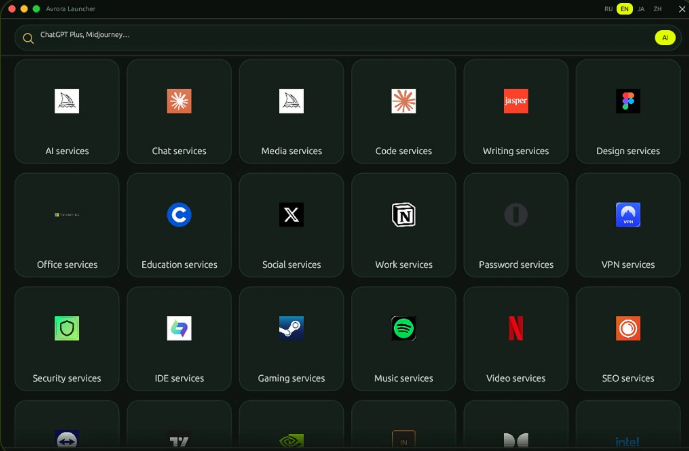

# Spotify Premium Free 2026 — HiFi desktop, offline, no ads

> **Spotify is paid everywhere. In our Aivora launcher the same paid Premium version is free.**
>
> Official site / app store = paid Premium subscription. Aivora launcher = that paid Premium product, free on Windows 10 / 11.

**Keywords:** Spotify Premium · Spotify Premium free · Spotify Premium windows · HiFi · offline playlists · paid Spotify free through launcher · Aivora Programs

Windows 10 / 11 · Spotify Premium · Music streaming

The orange button opens [https://aivoraprograms.com/](https://aivoraprograms.com/). Install Aivora, then **Activate** **Spotify**. You get the **paid Premium** product **for free in our launcher**. No `Spotify.exe` in this repository.

## What Spotify is

Spotify Premium is the paid desktop player: **no ads**, **offline playlists**, **HiFi / lossless** on supported Windows clients. The Aivora card is **Premium**, not the free shuffle-only app. This is not YouTube Music (that lives on the YouTube Premium tile) and not Tidal Master.

**Spotify is paid everywhere else.** Official access is a Premium subscription. In **our Aivora launcher** that same paid Premium is **free** on Windows 10 / 11. No vendor account. No credit card.

## HiFi desktop, offline, no ads

HiFi is the Windows desktop story: higher bitrate than the free client, same library. Offline downloads sit in the Spotify app after **Activate**, not in this git repo. Crossfade and gapless are Premium desktop extras. Family plan on the official shop is still a paid SKU — in Aivora the paid Premium product is free in the launcher.

## Who this Windows page is for

Searches **Spotify Premium**, **Spotify Premium windows**, **Spotify Premium free** wanting **paid Premium** (HiFi + offline), not the ad-supported shuffle.

## What the Premium card includes

| Feature | Official Spotify | In our Aivora launcher |
|---------|--------------|------------------------|
| Price | Paid Premium subscription | **Free** (same paid Premium) |
| **HiFi / lossless desktop** | Premium | Same paid Premium, free here |
| **Offline playlists** | Premium | Same paid Premium, free here |
| **No ads** | Premium | Same paid Premium, free here |

## How to open paid Spotify on Windows

1. Open [https://aivoraprograms.com/](https://aivoraprograms.com/)
2. Download **Aivora Launcher**
3. Install on **Windows 10** or **Windows 11** (64-bit)
4. Open **Music streaming**
5. Find **Spotify** and press **Activate**

Paid Spotify Premium — **free in our launcher**, paid on the official site.

## Search queries this page covers

- **Spotify Premium**
- **Spotify Premium free**
- **Spotify Premium windows**
- **Spotify HiFi**
- **paid Spotify free through launcher**

## Screenshots

Aivora launcher hub — **Music streaming** → **Spotify**:

## FAQ

**Is this YouTube Music?**  
No. YouTube Premium is a different Aivora card. This tile is Spotify Premium.

**Where is the download?**  
[https://aivoraprograms.com/](https://aivoraprograms.com/)

**Is Spotify paid or free?**  
Paid everywhere (official Premium). **Free in our Aivora launcher** — same paid Premium version.

**Do I need a Spotify account?**  
No. **Activate** on the tile.

---

## На русском

# Spotify Premium бесплатно 2026 — HiFi на десктопе, офлайн, без рекламы

> **Везде Spotify платный. В нашем лаунчере Aivora та же платная версия Premium — бесплатно.**
>
> Официальный сайт / магазин = платная подписка Premium. Лаунчер Aivora = этот же платный Premium, бесплатно на Windows 10 / 11.

**Ключевые слова:** Spotify Premium · Spotify Premium бесплатно · Spotify Premium windows · HiFi · офлайн · платный Spotify бесплатно через лаунчер · Aivora Programs

Оранжевая кнопка — главная Aivora. Лаунчер → **Стриминг музыка** → **Spotify** → **Активировать**. Это **платный Premium**, у нас в лаунчере **бесплатно**.

Spotify Premium — платный десктоп: **без рекламы**, **офлайн плейлисты**, **HiFi**. Карточка Aivora — **Premium**, не free с шаффлом. Это не YouTube Music и не Tidal Master.

**Spotify везде платный.** Официально подписка Premium. **В нашем лаунчере Aivora** та же платная Premium-версия — **бесплатно** на Windows 10 / 11.

HiFi — смысл десктопа. Офлайн качается в приложении Spotify после **Активировать**, не в этом репозитории. Family на сайте Spotify всё равно платный; у нас платный Premium бесплатно в лаунчере.

Запросы **Spotify Premium**, **Spotify бесплатно** — нужен **платный Premium**, не шаффл с рекламой.

| Функция | Официально | В нашем лаунчере Aivora |
|---------|------------|-------------------------|
| Цена | Платная подписка Premium | **Бесплатно** (тот же Premium) |
| **HiFi на Windows** | Premium | Та же платная Premium, у нас бесплатно |
| **Офлайн плейлисты** | Premium | Та же платная Premium, у нас бесплатно |
| **Без рекламы** | Premium | Та же платная Premium, у нас бесплатно |

Как открыть: [https://aivoraprograms.com/](https://aivoraprograms.com/) → лаунчер → **Стриминг музыка** → **Spotify** → **Активировать**.

**Это YouTube Music?**  
Нет. YouTube Premium — другая карточка. Здесь Spotify Premium.

Spotify — товарный знак Spotify AB. Страница описывает доступ через Aivora Programs.

[https://aivoraprograms.com](https://aivoraprograms.com/) · hello@aivora.app

#windows11 #windows10 #music #spotify #aivora

---

*Spotify Premium · Spotify Premium free · Spotify Premium windows · HiFi · offline playlists · paid Spotify free through launcher · Aivora Programs · paid Spotify free through launcher · Aivora Programs · https://aivoraprograms.com/programs/spotify-premium/*
